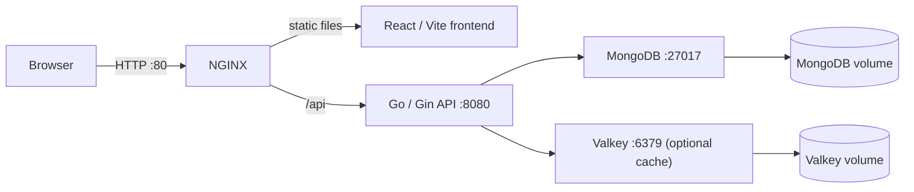
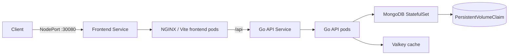

# DevOps Practical Exam - ProjectHub

## Deployment status

| Deployment | URL | Verified result |
|---|---|---|
| Docker Compose | http://192.168.160.50 | Frontend HTTP 200; API reports database and cache `up` |
| Kubernetes Gateway API | http://192.168.160.59:30080 | Gateway programmed; frontend HTTP 200; API health `status=ok`, database/cache `up` |

This repository deploys the provided ProjectHub source: React/Vite, Go/Gin, MongoDB, and Valkey.
The images published to Docker Hub are `headie1/projecthub-nextjs:latest` and
`headie1/projecthub-backend:latest`.

**Exam brief discrepancy:** The DOCX describes MyDiary with Next.js, Spring Boot, PostgreSQL, and
Redis, while the supplied source and verified deployments use ProjectHub with React/Vite, Go/Gin,
MongoDB, and Valkey. The DOCX also conflicts on the VM operating system: Task 1 says Ubuntu 24.04,
while its overview/template says Fedora 45; the deployed VMs use Fedora 45. This README documents
the source and environment that were provided and deployed; confirm these brief/template mismatches
with the examiner.

## VM inventory

| VM | Proxmox node | VMID | DHCP IPv4 |
|---|---|---:|---|
| `c3-docker-host` | `Server1` | 126 | `192.168.160.50` |
| `c3-k8s-master` | `Server1` | 125 | `192.168.160.59` |
| `c3-k8s-worker-1` | `Server1` | 128 | `192.168.160.63` |
| `c3-k8s-worker-2` | `Server1` | 127 | `192.168.160.60` |

Proxmox endpoint: `192.168.160.16:8006`; pool: `exam-c3`; clone template VMID: `9003`.
### Examiner VM access

SSH user: `qt`. Supply the exam password to the examiner through an approved secure channel; it is
intentionally not included in this repository.

In PowerShell, set the password only for the current session when running Ansible:

```powershell
$env:VM_PASSWORD = Read-Host 'VM password'
```

## Architecture

### Docker Compose



The Compose file intentionally does not publish database or cache ports to the host. The Compose
deployment is already verified and should not be changed as part of the remaining Kubernetes work.

### Kubernetes



Kubernetes namespace: `qt-spring-app`. The frontend NGINX configuration proxies `/api/` to the
backend Service. MongoDB uses persistent storage; Valkey is an optional cache.

## Task 1 - Provisioning and Terraform IP discovery

From PowerShell:

```powershell
cd C:\Users\mahinga\Desktop\mydiary\iac
$terraform = "$env:LOCALAPPDATA\Microsoft\WinGet\Packages\Hashicorp.Terraform_Microsoft.Winget.Source_8wekyb3d8bbwe\terraform.exe"
if (-not (Test-Path $terraform)) { throw "Terraform not found at $terraform" }
$env:TF_VAR_proxmox_api_token_secret = Read-Host 'Proxmox API token secret'
$env:TF_VAR_vm_password = Read-Host 'VM initialization password'
& $terraform init
& $terraform plan -out=tfplan
& $terraform apply tfplan
& $terraform apply -refresh-only
& $terraform output -json vm_ips
Remove-Item Env:TF_VAR_proxmox_api_token_secret
Remove-Item Env:TF_VAR_vm_password
```

`vm_ips` is derived from each VM's QEMU guest-agent IPv4 addresses; IPs are not hardcoded in the
Terraform output. The VM template must have `qemu-guest-agent` installed and running, and the
Proxmox API token needs `VM.GuestAgent.Audit` and `VM.GuestAgent.Unrestricted` permissions on the
VMs. If output still says `address-pending`, check those prerequisites, then rerun the refresh-only
apply and output command.

The checked-in `iac/variables.tf` deliberately requires `vm_password` as a sensitive variable. Do
not put the password into `terraform.tfvars` or commit that file.

### Evidence

```text
terraform plan -out=tfplan
Plan: 0 to add, 4 to change, 0 to destroy.

Changes to Outputs:
  ~ vm_ips = {
      ~ c3-docker-host  = "address-pending" -> "192.168.160.50"
      ~ c3-k8s-master   = "address-pending" -> "192.168.160.59"
      ~ c3-k8s-worker-1 = "address-pending" -> "192.168.160.63"
      ~ c3-k8s-worker-2 = "address-pending" -> "192.168.160.60"
    }

terraform apply tfplan
Apply complete! Resources: 0 added, 4 changed, 0 destroyed.

terraform output -json vm_ips
{"c3-docker-host":"192.168.160.50","c3-k8s-master":"192.168.160.59","c3-k8s-worker-1":"192.168.160.63","c3-k8s-worker-2":"192.168.160.60"}
```

## Task 2 - Docker Compose

The deployment is already running on `c3-docker-host`:

- Frontend: `http://192.168.160.50`
- API health: `http://192.168.160.50/api/health`
- Containers: `docker-nginx-1`, `docker-nextjs-1`, `docker-springboot-1`,
  `docker-postgres-1` (MongoDB), and `docker-redis-1` (Valkey).

Run Compose commands from the directory containing `docker-compose.yml`; otherwise Compose reports
that it cannot find a configuration file.

The Task 5 log check is a one-time command, not a process that must keep running. If the deployment
copy of the Compose file is unavailable on the VM, `docker logs --tail=50 docker-springboot-1`
retrieves the API container logs without changing the running services. The submitted Compose
definition remains in `docker/docker-compose.yml`.

The cache is Valkey (`valkey/valkey:8-alpine`), a Redis-compatible service. Compose calls it
`redis`/`docker-redis-1`; Kubernetes uses the `redis` Deployment and Service.

The API CORS allowlist includes the local development origin and both deployed frontend origins.
The Docker NGINX proxy also removes the `Origin` header from same-origin `/api/` requests before
forwarding them to the API.

## Task 3 - Kubernetes setup and repeatable CNI fix

The cluster inventory is in `ansible/inventory.ini`. The playbook now copies Fedora CNI plugin
binaries from `/usr/libexec/cni` into `/opt/cni/bin`, preserves their executable modes, configures
containerd to use `/opt/cni/bin`, and restarts containerd/kubelet only when a relevant file changes.
The playbook reapplies the Flannel manifest idempotently on the control plane.

Run from PowerShell. The password is prompted for and passed to Ubuntu/WSL for this command only:

```powershell
$env:VM_PASSWORD = Read-Host 'VM password'
if ($env:WSLENV -notmatch '(^|:)VM_PASSWORD($|:)') {
    if ($env:WSLENV) { $env:WSLENV += ':VM_PASSWORD' } else { $env:WSLENV = 'VM_PASSWORD' }
}
wsl -d Ubuntu -- bash -lc 'cd /mnt/c/Users/mahinga/Desktop/mydiary/ansible && ANSIBLE_HOST_KEY_CHECKING=False ~/.venvs/ansible/bin/ansible-playbook -i inventory.ini site.yml'
Remove-Item Env:VM_PASSWORD
```

Expected: the play recap has `failed=0` for the master and both workers. The playbook applies the
Flannel manifest. If doing that separately, run on the master:

```bash
kubectl apply -f https://raw.githubusercontent.com/flannel-io/flannel/master/Documentation/kube-flannel.yml
```

### Evidence

```text
wsl -d Ubuntu -- bash -lc '... ansible-playbook -i inventory.ini site.yml'

TASK [Verify containerd CNI plugin directory is populated] ... ok
TASK [Require CNI plugin binaries] ... "All assertions passed"
TASK [Initialize kubeadm] ... ok
TASK [Install Flannel CNI] ... ok
TASK [Join Kubernetes cluster] ... ok

PLAY RECAP
c3-k8s-master   : ok=27 changed=4 unreachable=0 failed=0
c3-k8s-worker-1 : ok=23 changed=3 unreachable=0 failed=0
c3-k8s-worker-2 : ok=23 changed=3 unreachable=0 failed=0
```

## Task 4 - Apply and verify Kubernetes application manifests

The Kubernetes manifests use the published `headie1/*:latest` images. `MONGO_URI` is set in both
the ConfigMap and Helm chart configuration. The backend gets `VALKEY_PASSWORD` from the
`app-secrets` Secret's `CACHE_PASSWORD` key. The ConfigMap also allows the Docker Compose and
Kubernetes frontend origins through `CORS_ORIGINS`, so browser login POSTs are not rejected by CORS.
The Gateway API entry point uses port `30080`; the direct frontend NodePort is `30082`.

The local `k8s/02-secrets.yaml` contains sensitive values and is ignored by Git. Do not copy it into
the submission or apply it. The running cluster already has `app-secrets`; for a fresh cluster,
create that Secret out-of-band from locally supplied `JWT_SECRET` and `CACHE_PASSWORD` environment
variables before deploying. Helm also expects that pre-created Secret.

Run these commands from the repository root in a shell whose `kubectl` context targets this
cluster, or on the master after making the listed manifest files available there. This intentionally
excludes the local secret file, Helm chart, and Gateway API resources; their separate bonus steps
follow the verification results:

```bash
kubectl apply -f k8s/00-namespace.yaml
kubectl apply -f k8s/01-config.yaml
kubectl apply -f k8s/03-pv-pvc.yaml
kubectl apply -f k8s/04-mongodb.yaml
kubectl apply -f k8s/05-redis.yaml
kubectl apply -f k8s/06-backend.yaml
kubectl apply -f k8s/07-frontend.yaml
kubectl apply -f k8s/09-nginx-config.yaml
kubectl apply -f k8s/08-nodeport.yaml
```

If updated deployments need a restart:

```bash
kubectl -n qt-spring-app rollout restart deployment/springboot deployment/nextjs
kubectl -n qt-spring-app rollout status deployment/springboot
kubectl -n qt-spring-app rollout status deployment/nextjs
```

Final verification:

```bash
kubectl get nodes -o wide
kubectl get pods -A -o wide
kubectl -n kube-flannel get pods -o wide
kubectl -n qt-spring-app get deployments,pods,services,pvc
curl -i http://192.168.160.59:30082/
curl -i http://192.168.160.59:30082/api/health
```

Observed: all nodes `Ready`; Flannel pods `Running`; frontend `2/2`, backend `3/3`, Redis `1/1`,
MongoDB `1/1`; PVC `Bound`; frontend HTTP 200; API health returned `status=ok`, `database=up`,
`cache=up`.

The verification output below was captured before the Gateway cutover, when the direct frontend
NodePort was `30080`. The current direct frontend NodePort is `30082`; Gateway API now serves the
exam URL on `30080`.

### Verification results

```text
kubectl get nodes -o wide
c3-k8s-master     Ready  control-plane  192.168.160.59
c3-k8s-worker-1   Ready  <none>         192.168.160.63
c3-k8s-worker-2   Ready  <none>         192.168.160.60

kubectl get pods -A -o wide
All listed kube-system, kube-flannel, and qt-spring-app pods were Running and Ready.

kubectl -n kube-flannel get pods -o wide
3 Flannel pods: 1/1 Running

kubectl -n qt-spring-app get deployments,pods,services,pvc
nextjs 2/2; redis 1/1; springboot 3/3
mongodb-0 1/1 Running; mongodb-pvc Bound (10Gi)

curl -i http://192.168.160.59:30080/
HTTP/1.1 200 OK

curl -i http://192.168.160.59:30080/api/health
HTTP/1.1 200 OK
{"status":"ok","database":"up","cache":"up"}
```

## Bonus - Helm chart

The local chart in `k8s/helm/` packages the application deployments, services, and configuration.
It reuses the existing `mongodb-pvc` and `app-secrets`; it does not manage or replace either one.
The Namespace and persistent-volume resources also remain outside the release.

Validate and inspect the rendered resources locally:

```bash
helm lint k8s/helm
helm template projecthub k8s/helm --namespace qt-spring-app
```

The live application was originally applied with `kubectl`. I transferred its existing resources
to Helm 4.3.2 using `--take-ownership --force-conflicts`; this resolved the two expected field
ownership conflicts for `CORS_ORIGINS` and the direct NodePort. The chart does not manage the
existing Secret, PVC, or PV. Review the rendered resources before adopting them:

```bash
helm upgrade --install projecthub k8s/helm \
  --namespace qt-spring-app \
  --take-ownership \
  --force-conflicts \
  --wait --timeout 5m
kubectl -n qt-spring-app rollout restart deployment/springboot
kubectl -n qt-spring-app rollout status deployment/springboot
helm -n qt-spring-app status projecthub
kubectl -n qt-spring-app get deployments,pods,services,pvc
curl -i http://192.168.160.59:30080/api/health
```

Do not apply `k8s/02-secrets.yaml`; the existing `app-secrets` must remain created out of band.

Verified: release `projecthub` is deployed at chart version `0.2.0`; frontend `2/2`, backend `3/3`,
Redis `1/1`, MongoDB `1/1`, and the existing 10Gi PVC remains Bound. The API health endpoint
returns HTTP 200.

## Bonus - Gateway API

The cluster uses Kubernetes 1.31, so the Gateway controller is pinned to NGINX Gateway Fabric
`2.6.8`, which supports Kubernetes 1.31. The Gateway data plane uses NodePort `30080`, preserving
the existing exam URL; the direct frontend Service uses NodePort `30082`.

Use a kubectl 1.31.x client and confirm the current context targets the exam cluster, not Docker
Desktop. The commands below were run with the exam kubeconfig and kubectl v1.31.14:

```bash
kubectl kustomize "https://github.com/nginx/nginx-gateway-fabric/config/crd/gateway-api/standard?ref=v2.6.8" | kubectl apply -f -
helm upgrade --install ngf oci://ghcr.io/nginx/charts/nginx-gateway-fabric \
  --version 2.6.8 \
  --namespace nginx-gateway --create-namespace \
  --values k8s/gateway-ngf-values.yaml \
  --wait --timeout 5m
kubectl apply -f k8s/10-gateway.yaml
kubectl apply -f k8s/01-config.yaml
kubectl -n qt-spring-app rollout restart deployment/springboot
kubectl -n qt-spring-app rollout status deployment/springboot
```

The `Gateway` and `HTTPRoute` send `/api` to the backend Service and other paths to the frontend
Service. Verify that the Gateway is programmed and both endpoints respond:

```bash
kubectl get gatewayclass nginx
kubectl -n qt-spring-app get gateway,httproute
kubectl -n qt-spring-app get service projecthub-gateway-nginx
curl -i http://192.168.160.59:30080/
curl -i http://192.168.160.59:30080/api/health
```

Verified: GatewayClass `nginx` is Accepted; `projecthub-gateway` is Programmed; the HTTPRoute is
Accepted with references resolved; the Gateway Service uses NodePort `30080`; frontend and API
health both return HTTP 200 (`status=ok`, database/cache `up`).

```text
helm status projecthub -n qt-spring-app
STATUS: deployed

helm status ngf -n nginx-gateway
STATUS: deployed

kubectl get gatewayclass nginx
nginx   gateway.nginx.org/nginx-gateway-controller   ACCEPTED=True

kubectl get gateway projecthub-gateway -n qt-spring-app
PROGRAMMED=True

kubectl describe httproute projecthub-route -n qt-spring-app
Accepted=True; ResolvedRefs=True

kubectl get service projecthub-gateway-nginx -n qt-spring-app
80:30080/TCP

curl -i http://192.168.160.59:30080/
HTTP/1.1 200 OK

curl -i http://192.168.160.59:30080/api/health
HTTP/1.1 200 OK
{"status":"ok","database":"up","cache":"up"}
```

## Resilience proof

Run these commands from a shell with access to the Kubernetes cluster. Save the command output and
screenshots alongside the Task 5 evidence.

### Scale the API and prove a deleted pod is replaced

```bash
kubectl -n qt-spring-app scale deployment/springboot --replicas=3
kubectl -n qt-spring-app rollout status deployment/springboot
kubectl -n qt-spring-app get pods -l app=springboot -o wide
POD=$(kubectl -n qt-spring-app get pods -l app=springboot -o jsonpath='{.items[0].metadata.name}')
echo "Deleting $POD"
kubectl -n qt-spring-app delete pod "$POD"
kubectl -n qt-spring-app get pods -l app=springboot -w
```

Expected: the deleted pod terminates and a replacement appears; three backend pods return to
`Running`/`Ready`. Press Ctrl+C after the replacement is ready; this stops the watch only.

### Delete the cache pod and prove the workload recovers

```bash
kubectl -n qt-spring-app delete pod -l app=redis
kubectl -n qt-spring-app get pods -l app=redis -w
```

Expected: the Deployment creates a replacement Redis/Valkey pod. Press Ctrl+C after it is ready.

### Hold the optional cache down and verify the app remains available

```bash
kubectl -n qt-spring-app scale deployment/redis --replicas=0
kubectl -n qt-spring-app get pods -l app=redis
curl -i http://192.168.160.59:30080/
curl -i http://192.168.160.59:30080/api/health
```

Expected: frontend remains HTTP 200 and API health remains `status=ok`, `database=up`, with
`cache=down`. Restore normal operation afterward:

```bash
kubectl -n qt-spring-app scale deployment/redis --replicas=1
kubectl -n qt-spring-app rollout status deployment/redis
curl -i http://192.168.160.59:30080/api/health
```

### Results

| Proof | Actual result / screenshot reference |
|---|---|
| API replicas scaled to 3 | Deployment reached `3/3`; [vm1-k8s-master-sc8.png](./monitoring/vm1-k8s-master-sc8.png) |
| Deleted API pod replaced | Replacement became ready and deployment remained `3/3`; [vm1-k8s-master-sc9.png](./monitoring/vm1-k8s-master-sc9.png), [vm1-k8s-master-sc10.png](./monitoring/vm1-k8s-master-sc10.png) |
| Deleted cache pod replaced | Redis returned to `1/1`; API health reported database/cache `up`; [vm1-k8s-master-sc11.png](./monitoring/vm1-k8s-master-sc11.png), [vm1-k8s-master-sc12.png](./monitoring/vm1-k8s-master-sc12.png) |
| Frontend/API remained available with cache scaled to 0 | Frontend HTTP 200; health reported `status=ok`, `database=up`, `cache=down`; Redis deployment `0/0` (pod was `Terminating` when captured); [vm1-k8s-master-sc13.png](./monitoring/vm1-k8s-master-sc13.png) |
| Cache restored and health reports `up` | Redis returned to `1/1`; API health reported database/cache `up`; [vm1-k8s-master-sc14.png](./monitoring/vm1-k8s-master-sc14.png) |

## Task 5 - Monitoring screenshots

Screenshots are in `monitoring/`. Commands in each row are the likely checklist commands based on
the visible terminal output; some screenshots combine multiple commands. The directory now contains
30 screenshots.

| Screenshot | VM | Observed information | Likely command(s) |
|---|---|---|---|
| `vm2-docker-host-htop.png` | `vm2-docker-host` | Interactive process/CPU/memory view; Docker-host application processes are visible | `top` |
| `vm2-docker-host-df.png` | `vm2-docker-host` | Disk, memory, uptime, listeners, and VM statistics; includes an initial missing-`iostat` message | `df -hT`, `free -h`, `uptime`, `ss -tulpn`, `vmstat 1 5` |
| `vm2-docker-host-iostat.png` | `vm2-docker-host` | Disk I/O and CPU samples | `iostat 1 5` |
| `vm2-docker-host-psaux.png` | `vm2-docker-host` | Top processes by CPU | `ps aux --sort=-%cpu \| head -n 30` |
| `vm2-docker-host-docker-ps.png` | `vm2-docker-host` | Container list and Valkey statistics | `docker ps`, `docker exec ... valkey-cli ... info stats` |
| `vm2-docker-host-docker-stats.png` | `vm2-docker-host` | Live container resource use | `docker stats` |
| `vm2-docker-host-docker-compose-ps.png` | `vm2-docker-host` | Compose service state and API logs | `docker compose ps`, `docker compose logs --tail=50 springboot` |
| `vm2-docker-host-api-health.png` | `vm2-docker-host` | API health: `status=ok`, database/cache `up` | `curl -sS http://192.168.160.50/api/health` |
| `vm1-k8s-master-htop.png` | `vm1-k8s-master` | Interactive process/CPU/memory view | `top` |
| `vm1-k8s-master-df.png` | `vm1-k8s-master` | Disk, memory, uptime, and listening sockets | `df -hT`, `free -h`, `uptime`, `ss -tulpn` |
| `vm1-k8s-master-iostat.png` | `vm1-k8s-master` | VM and disk I/O samples | `vmstat 1 5`, `iostat 1 5` |
| `vm1-k8s-master-sc4.png` | `vm1-k8s-master` | Top processes by CPU | `ps aux --sort=-%cpu \| head -n 30` |
| `vm1-k8s-master-sc5.png` | `vm1-k8s-master` | Node/pod/deployment status and NodePort checks | `kubectl get nodes`, `kubectl get pods -A -o wide`, `kubectl -n qt-spring-app get deployments/pods`, `curl` |
| `vm1-k8s-master-sc6.png` | `vm1-k8s-master` | All three nodes Ready; Flannel and workload pods Running; deployments and PVC; frontend HTTP 200 | `kubectl get nodes -o wide`, `kubectl get pods -A -o wide`, `kubectl -n kube-flannel get pods -o wide`, `kubectl -n qt-spring-app get deployments,pods,services,pvc`, `curl` |
| `vm1-k8s-master-sc7.png` | `vm1-k8s-master` | Backend `3/3`, Redis `1/1`, PVC Bound, frontend HTTP 200 and API health `up` | `kubectl -n qt-spring-app get deployments,pods,services,pvc`, `curl -i` |
| `vm1-k8s-master-sc8.png` | `vm1-k8s-master` | Backend scaled to three ready replicas | `kubectl scale deployment/springboot --replicas=3`, `kubectl rollout status`, `kubectl get pods` |
| `vm1-k8s-master-sc9.png` | `vm1-k8s-master` | Deleted backend pod and observed replacement become Running/Ready | `kubectl delete pod`, `kubectl get pods -l app=springboot -w` |
| `vm1-k8s-master-sc10.png` | `vm1-k8s-master` | Final backend state after replacement: three pods Running/Ready | `kubectl get deployment springboot`, `kubectl get pods -l app=springboot -o wide` |
| `vm1-k8s-master-sc11.png` | `vm1-k8s-master` | Deleted Redis pod and observed replacement become Running/Ready | `kubectl delete pod -l app=redis`, `kubectl get pods -l app=redis -w` |
| `vm1-k8s-master-sc12.png` | `vm1-k8s-master` | Redis `1/1`; API health reports database/cache `up` | `kubectl get deployment redis`, `kubectl get pods -l app=redis`, `curl -i /api/health` |
| `vm1-k8s-master-sc13.png` | `vm1-k8s-master` | Redis scaled to `0/0`; frontend HTTP 200; health reports cache `down` | `kubectl scale deployment/redis --replicas=0`, `kubectl get pods`, `curl` |
| `vm1-k8s-master-sc14.png` | `vm1-k8s-master` | Redis restored to `1/1`; API health reports cache `up` | `kubectl scale deployment/redis --replicas=1`, `kubectl rollout status`, `curl -i /api/health` |
| `vm3-k8s-worker1-sc1.png` | `vm3-k8s-worker1` | Interactive process/CPU/memory view | `top` |
| `vm3-k8s-worker1-sc2.png` | `vm3-k8s-worker1` | Disk, memory, uptime, listeners, and VM statistics | `df -hT`, `free -h`, `uptime`, `ss -tulpn`, `vmstat 1 5` |
| `vm3-k8s-worker1-sc3.png` | `vm3-k8s-worker1` | Disk I/O and CPU samples | `iostat 1 5` |
| `vm3-k8s-worker1-sc4.png` | `vm3-k8s-worker1` | Top processes by CPU | `ps aux --sort=-%cpu \| head -n 30` |
| `vm4-k8s-worker2-sc1.png` | `vm4-k8s-worker2` | Interactive process/CPU/memory view | `top` |
| `vm4-k8s-worker2-sc2.png` | `vm4-k8s-worker2` | Disk, memory, uptime, listeners, and VM statistics | `df -hT`, `free -h`, `uptime`, `ss -tulpn`, `vmstat 1 5` |
| `vm4-k8s-worker2-sc3.png` | `vm4-k8s-worker2` | Disk I/O and CPU samples | `iostat 1 5` |
| `vm4-k8s-worker2-sc4.png` | `vm4-k8s-worker2` | Top processes by CPU | `ps aux --sort=-%cpu \| head -n 30` |

**Evidence note:** `vm2-docker-host-htop.png` is from the active `c3-docker-host` terminal tab.
The Redis-stat command in `vm2-docker-host-docker-ps.png` has been redacted before external sharing.

## Task-by-task evidence checklist

- [x] **Task 1:** Terraform plan/apply and VMID/IP mapping; `terraform output -json vm_ips` verified.
- [x] **Task 2:** Docker frontend, API health, Compose deployment, and login verified.
- [x] **Task 3:** Ansible recap with no failures; all three Kubernetes nodes Ready; Flannel pods Running.
- [x] **Task 4:** MongoDB PVC bound, app pods Ready, NodePort frontend and API health verified.
- [x] **Task 5:** Monitoring screenshots listed above; Docker-host tab is identified and Redis command
  is redacted.
- [x] **Resilience:** API pod replacement and availability while the optional cache is down.
- [x] **Bonus - Helm:** release `projecthub` deployed and verified; app health HTTP 200 (+5).
- [x] **Bonus - Gateway API:** Gateway programmed, route accepted, external NodePort checks HTTP 200 (+5).

## Submission summary

- Docker Compose: `http://192.168.160.50` — verified.
- Kubernetes Gateway API: `http://192.168.160.59:30080` — verified; direct frontend NodePort: `30082`.
- Docker Hub images: `headie1/projecthub-nextjs:latest`,
  `headie1/projecthub-backend:latest`.
- SSH user: `qt`; VM password is supplied separately through a secure channel.

| VM | VMID | IP | SSH user |
|---|---:|---|---|
| `c3-docker-host` | 126 | `192.168.160.50` | `qt` |
| `c3-k8s-master` | 125 | `192.168.160.59` | `qt` |
| `c3-k8s-worker-1` | 128 | `192.168.160.63` | `qt` |
| `c3-k8s-worker-2` | 127 | `192.168.160.60` | `qt` |

Required repository folders: `iac/`, `ansible/`, `docker/`, `k8s/`, `app/`, and `monitoring/`.
Evidence screenshots are stored in `monitoring/`.

## Test accounts

The application seeds these accounts on an empty database:

| Role | Email | Password |
|---|---|---|
| admin | admin@qt.rw | Admin@123 |
| manager | manager@qt.rw | Manager@123 |
| member | member@qt.rw | Member@123 |
